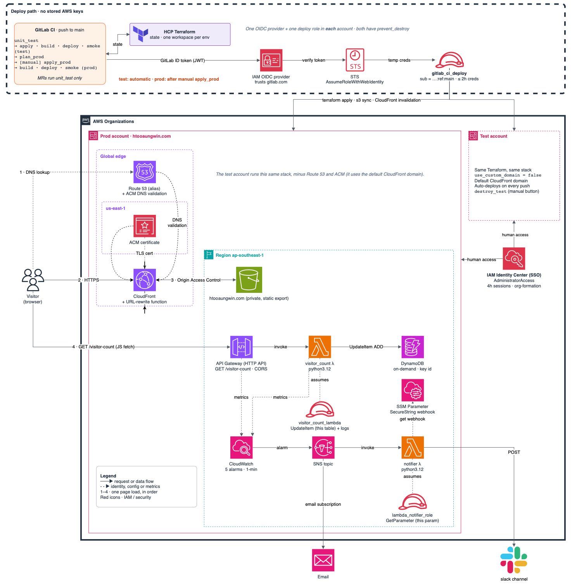
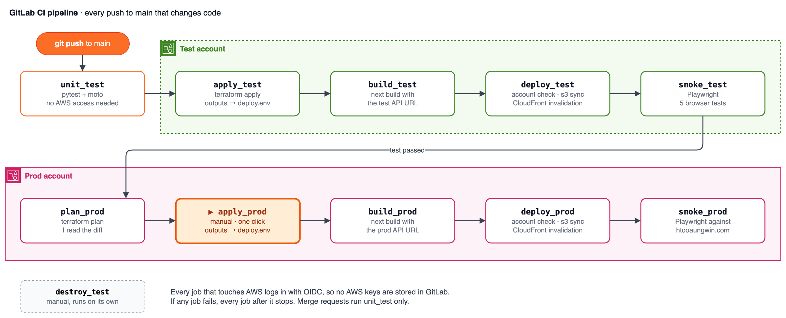

# htooaungwin.com

My resume website, built as the [Cloud Resume Challenge](https://cloudresumechallenge.dev) with most of its DevOps mods. This repo contains the frontend, the AWS infrastructure in Terraform across two AWS accounts, a GitLab CI pipeline that deploys to test before prod, automated tests, and monitoring with alerts that reach email and Slack.

- **Live site:** https://htooaungwin.com
- **Blog post:** [My Cloud Resume Challenge, the DevOps way](https://dev.to/htooaw/my-cloud-resume-challenge-the-devops-way-2abh)

## Architecture



## How it works

**A page load.** The visitor's browser looks up `htooaungwin.com` in Route 53, which points to CloudFront. CloudFront serves the site over HTTPS (ACM certificate in `us-east-1`) from a private S3 bucket, reading it through Origin Access Control. The page then calls `GET /visitor-count` on an API Gateway HTTP API. That runs a Python Lambda, which adds one to the count in DynamoDB and returns the new number.

**An alert.** Five CloudWatch alarms watch the Lambda and the API. When one fires, it publishes to an SNS topic. SNS emails me and triggers a notifier Lambda, which reads the Slack webhook from SSM Parameter Store and posts the alert to Slack.

**A deploy.** A push to `main` starts the GitLab pipeline. Each job gets a short-lived ID token from GitLab and trades it for temporary AWS credentials through OIDC. The pipeline deploys and tests the test account automatically, then plans prod and waits for me to approve it.

## Key design decisions

**Two AWS accounts, not two stages.** Test and Prod are separate AWS accounts in one AWS Organization, built from the same Terraform, as the book's DevOps mod recommends. Each account has its own credentials, state and settings, so a mistake in test stays in the test. The Organization itself, with its accounts, OUs, and SSO access, is defined in code with [org-formation-cli](https://github.com/org-formation/org-formation-cli), the book's "extra credit" step, instead of being set up by hand in the console.

**OIDC instead of stored AWS keys.** GitLab never holds AWS credentials. The CI role's trust policy only accepts tokens from the `main` branch of this project.

**Test is automatic, prod has one manual gate.** Every push goes through unit tests, a test deploy and browser smoke tests. Prod is only deployed after all of that passes, and only after I've read `plan_prod`.

**One repo, with Terraform outputs passed between jobs.** The website build needs the API URL, which Terraform only knows after `apply`. The apply job writes its outputs to a dotenv artifact, and the build job reads them. In one repo that's one pipeline in the right order. (The book suggests separate repos.)

**A private bucket instead of S3 website hosting.** The bucket is never public. Only my CloudFront distribution can read it, enforced by OAC and a bucket policy scoped to the distribution's ARN. S3 website hosting serves `index.html` for folder paths automatically, but a private bucket doesn't, so I rewrite those URLs with a small CloudFront Function.

**An atomic counter.** The Lambda uses DynamoDB `UpdateItem` with `ADD`, not read-then-write, so two visitors at the same moment can't lose a count.

**`prevent_destroy` on the CI identity.** The OIDC provider and the CI role can't be destroyed by Terraform. I added this after a test teardown deleted the identity CI needed to log in.

**Terraform with state in HCP Terraform.** I picked Terraform over SAM because it isn't AWS-only. State moved to HCP Terraform after I nearly committed a state file to git.

**Secrets stay out of the repo.** The Slack webhook is an SSM SecureString. Per-environment values come from environment-scoped GitLab CI variables. `*.tfvars` and state are gitignored.

## Pipeline



| Job | What it does |
|---|---|
| `unit_test` | pytest + moto for the visitor counter Lambda |
| `apply_test` / `apply_prod` | `terraform apply`, then writes outputs (site URL, bucket, API URL, distribution ID) to a dotenv artifact |
| `build_test` / `build_prod` | Builds the Next.js static export with that environment's API URL baked in |
| `deploy_test` / `deploy_prod` | `aws s3 sync` to the bucket, then a CloudFront invalidation |
| `smoke_test` / `smoke_prod` | Playwright tests against the deployed site |
| `plan_prod` | Shows the prod diff before the manual approval |
| `destroy_test` | Manual teardown of the test environment, independent of the other jobs |

**When it runs:**

| Event | What runs |
|---|---|
| Push to `main` touching `lambda/`, `infra/`, `portfolio/`, `tests/` or `.gitlab-ci.yml` | The full pipeline |
| Merge request | `unit_test` only (the trust policy only allows `main`) |
| Docs-only push | Nothing |

If any job fails, everything after it stops.

## Environments

| | Test | Prod |
|---|---|---|
| AWS account | test account (Test OU) | prod account (Prod OU) |
| HCP workspace | `cloudresumechallenge-haw-test` | `cloudresumechallenge-haw-prod` |
| Deploys | automatically on push | after `plan_prod` and a manual `apply_prod` |
| Domain and TLS | default CloudFront domain | `htooaungwin.com` with Route 53 + ACM |
| Teardown | `destroy_test` button | none |

Prod has no teardown job on purpose. Taking it down would be a deliberate local `./tf prod destroy` with an admin login, not a button in the pipeline.

### One codebase, two environments

The same Terraform builds both. Three things change per environment, **which AWS account**, **which HCP workspace (state)**, and **which input values**. `use_custom_domain` is one of those inputs, it switches Route 53, ACM and the CloudFront aliases on for prod and off for test.

**In CI**, every job extends one of two small templates:

```yaml
.env_test:
  variables:
    TF_WORKSPACE: cloudresumechallenge-haw-test
    AWS_ROLE_ARN: arn:aws:iam::${TEST_ACCOUNT_ID}:role/gitlab_ci_deploy
  environment:
    name: test
```

- `TF_WORKSPACE` picks the HCP workspace, so test and prod never share state.
- `AWS_ROLE_ARN` picks the account. The OIDC token is traded for credentials in that account only.
- `environment: name: test` makes GitLab load that environment's scoped CI variables (the `TF_VAR_*` inputs, including the Slack webhook). A test job can't see prod's values, and the reverse.

The build, deploy and test steps are written once and shared. Only the template changes.

**Locally**, `infra/tf` does the same job for my laptop:

```bash
./tf test plan     # test account, test workspace, test.tfvars
./tf prod plan     # prod account, prod workspace, prod.tfvars
```

It sets the AWS profile, selects the HCP workspace and passes the right tfvars file in one step, so I can never plan prod's state with test's credentials or values. It also prints which environment it used, in red for prod and green for test. Locally I only run `plan`. Applies go through CI, because anything applied from a laptop and not committed gets reverted on the next pipeline run.

### Passing values between jobs (`deploy.env`)

The test environment has no fixed address. It uses the default CloudFront domain, and the API Gateway URL is generated by AWS. Both change if the environment is rebuilt, so nothing can be hardcoded. The later jobs need to know where everything is.

So the apply job asks Terraform and writes the answers to a file:

```yaml
- echo "TF_SITE_URL=$(terraform output -raw site_url)"                     >> ../deploy.env
- echo "TF_SITE_BUCKET=$(terraform output -raw site_bucket_name)"          >> ../deploy.env
- echo "TF_API_URL=$(terraform output -raw visitor_count_api_url)"         >> ../deploy.env
- echo "TF_CF_DIST_ID=$(terraform output -raw cloudfront_distribution_id)" >> ../deploy.env
- echo "TF_ACCOUNT_ID=$(terraform output -raw current_account_id)"         >> ../deploy.env
```

GitLab's `artifacts: reports: dotenv` turns each line into a variable for every later job that `needs` the apply job:

| Variable | Used by | For |
|---|---|---|
| `TF_API_URL` | build | Baked into the site as `NEXT_PUBLIC_VISITOR_COUNT_API`, so the counter calls the right API |
| `TF_SITE_BUCKET` | deploy | Where `aws s3 sync` uploads the site |
| `TF_CF_DIST_ID` | deploy | Which CloudFront cache to invalidate |
| `TF_ACCOUNT_ID` | deploy | A safety check (below) |
| `TF_SITE_URL` | deploy, smoke | The GitLab environment link, and where Playwright points its tests |

Three details that came out of this:

- **Each environment needs its own build.** Next.js bakes the API URL into the JavaScript at build time, so a test build can't be promoted to prod. The site is rebuilt per environment, with that environment's URL.
- **The deploy refuses to run in the wrong account.** Before uploading anything, it checks that the account it's logged into matches the account Terraform just applied to:
  ```bash
  test "$(aws sts get-caller-identity --query Account --output text)" = "$TF_ACCOUNT_ID"
  ```
  If they don't match, the job fails before touching S3.
- **The deploy waits for the CloudFront invalidation to finish**, so the smoke tests check the new version of the site, not a cached old one.

CORS follows the same idea. In Terraform, the API allows `htooaungwin.com` and `www.htooaungwin.com` in prod, and the test environment's own CloudFront domain in test.

### Configuration

Every value is a GitLab CI variable, none of them in the repo. The `TF_VAR_*` ones are set twice, once scoped to `test` and once to `prod`. The account IDs and the HCP token are shared by both.

| Variable | Test | Prod |
|---|---|---|
| `TF_VAR_site_bucket_name` | own bucket | own bucket |
| `TF_VAR_use_custom_domain` | `false` | `true` |
| `TF_VAR_site_domain` | empty | `htooaungwin.com` |
| `TF_VAR_alarm_notification_email` | masked | masked |
| `TF_VAR_slack_webhook_url` | masked, stored by Terraform in SSM as a SecureString | same |
| `TEST_ACCOUNT_ID` / `PROD_ACCOUNT_ID` | masked, shared | same |
| `TF_TOKEN_app_terraform_io` | masked, HCP Terraform API token | same |

Locally, the same `TF_VAR_*` values come from `test.tfvars` and `prod.tfvars`, which are gitignored.

org-formation follows the same rule. Its YAML keeps placeholders such as `<management-account-id>`, and `org-formation/ofn` fills them in from a gitignored `values.local` in a temporary copy before running. `values.local.example` lists the keys it needs.

### The AWS Organization (org-formation)

[org-formation-cli](https://github.com/org-formation/org-formation-cli) is an open-source tool that manages AWS Organizations as code, the way Terraform manages resources inside an account. It sits apart from the Terraform because the Organization is one level above it. The accounts and the SSO access have to exist before Terraform can deploy anything into them.

| File | What it defines |
|---|---|
| `organization.yml` | The management account, the Test and Prod OUs, and one account in each |
| `sso-assignments.yml` | An admin permission set with 4-hour sessions, and which accounts my SSO user can use it in. Deployed as a CloudFormation stack in the management account |
| `organization-tasks.yml` | Which of the two to apply, and in what order |
| `ofn` | Runs org-formation with the real IDs filled in (see Configuration) |

## Security

| Who | How they get into AWS | What they can do |
|---|---|---|
| GitLab CI | OIDC, only from `main` of this project | Deploy this stack; credentials last up to 2h |
| visitor_count Lambda | execution role | `dynamodb:UpdateItem` on one table, write logs |
| notifier Lambda | execution role | `ssm:GetParameter` on one parameter |
| Me | IAM Identity Center (SSO) | Admin, 4-hour sessions |

- No long-lived AWS access keys exist, for CI or for humans.
- The S3 bucket blocks all public access. Only CloudFront can read it.
- The API only accepts browser requests from the site's own domain (CORS).
- Account IDs, emails and webhooks are never hardcoded in the repo.

## Repo layout

```
.
├── portfolio/          Next.js static site (all résumé content is in lib/data.ts)
├── lambda/
│   ├── visitor_count/  counter Lambda + pytest tests
│   └── notifier/       SNS → Slack Lambda
├── infra/              Terraform for everything in AWS
│   └── tf              local wrapper: ./tf {prod|test} <command>
├── tests/browser/      Playwright smoke tests
├── org-formation/      AWS Organization, OUs and SSO access as code
│   └── ofn             local wrapper: ./ofn <command>, fills in real values from a gitignored file
├── docs/               architecture diagrams
└── .gitlab-ci.yml      the pipeline
```

## Tests

- **Unit (3 tests):** happy path, the count increments, and an error when the table is missing. DynamoDB is mocked with moto.
- **Browser (5 tests):** the homepage content loads, the résumé and profile links are real, the counter shows a real number, the counter goes up across page loads, and the page works on mobile without horizontal scrolling.

Running them locally:

```bash
# Lambda unit tests
pip install -r lambda/visitor_count/requirements-dev.txt
cd lambda/visitor_count && python -m pytest tests/ -v

# Frontend checks
cd portfolio && npm install && npm run typecheck && npm run lint && npm run build

# Terraform plan against an environment (needs an SSO login)
cd infra && ./tf test plan

# Browser smoke tests against a deployed site (on prod this adds to the real count)
cd tests/browser && npm install && SITE_URL=https://htooaungwin.com npx playwright test
```

## DevOps mods

| Mod | Status |
|---|---|
| Automation Nation (frontend in IaC, build, deploy and smoke test pipeline) | Done |
| Monitor Lizard (CloudWatch alarms, SNS, Slack) | Done, without PagerDuty |
| Browser Up (end-to-end test of the visitor counter) | Done |
| All The World's A Stage (test account, manual approval before prod) | Partly. No fresh test environment per merge request, no security checks yet, and test teardown is a manual button instead of running after each merge |

## Known limitations

- **The CI role is broader than it needs to be.** It no longer has AdministratorAccess, but some service permissions still use wildcards.
- **`destroy_test` can't run yet.** Terraform refuses to plan a destroy that includes `prevent_destroy` resources. The fix is moving the OIDC provider and CI role into their own state.
- **Long jobs can outlive their credentials.** The role allows two hours, but the pipeline doesn't request more than the default one-hour session yet.
- **The notifier Lambda can't write logs**, and its Slack request has no timeout.
- **No security scanning or Terraform linting in CI yet.**
- **Provider versions aren't locked.** The lock file is gitignored.

## More

- [Blog post](https://dev.to/htooaw/my-cloud-resume-challenge-the-devops-way-2abh): why I did it, the choices I made and the things that broke
- [`JOURNAL.md`](JOURNAL.md): my notes for each part of the challenge, with the real errors
